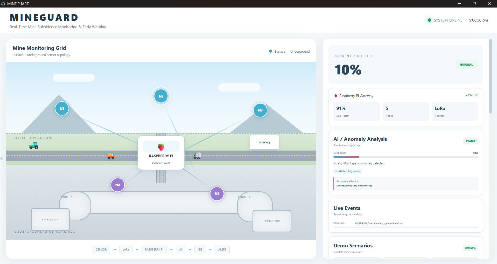
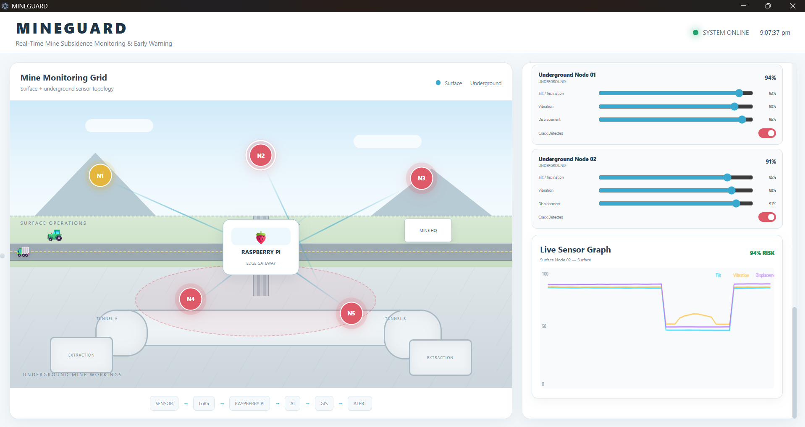
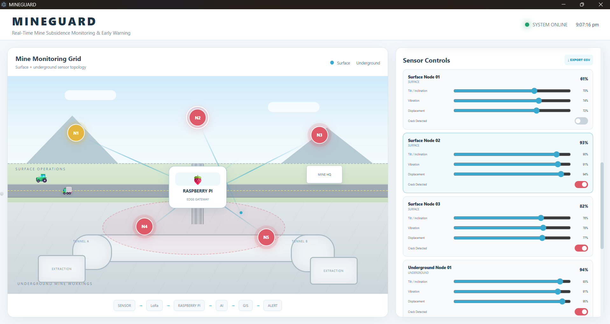
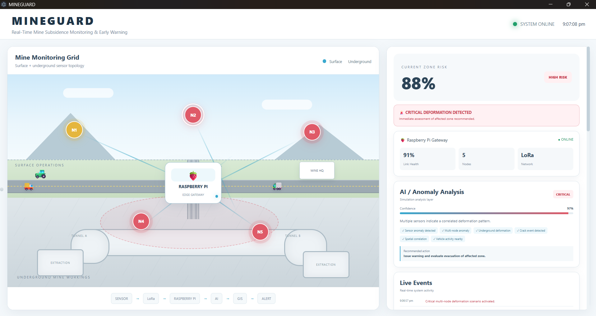

# MINEGUARD
### Exploring a Mine-Safety Monitoring Concept

MINEGUARD is an early-stage concept exploring how a desktop monitoring interface could help visualize mine conditions, potential hazards, and safety-related information.

This repository contains a **software UI showcase and simulation** for the concept. The aim is to demonstrate how a future mine-monitoring platform might present operational information through a centralized dashboard.

## Project Vision

The broader idea explores how environmental sensors, communication systems, monitoring dashboards, and alerts could work together to support mine-safety awareness.

Prototype hardware development is being pursued separately from this software showcase.

## What the Showcase Includes

- An Electron-based desktop application.
- A JavaScript-based mine-monitoring simulation.
- A graphical interface built with HTML and CSS.
- A demonstration of how simulated mine-related information could be presented to an operator.

The repository should be evaluated based on its implemented interface and simulation, not assumed future functionality.

## Technology Stack

- Electron
- JavaScript
- HTML and CSS
- Node.js and npm

## Project Structure

```text
MINEGUARD/
├── backend/
│   └── simulation.js
├── renderer/
│   ├── app.js
│   ├── index.html
│   └── style.css
├── main.js
├── preload.js
├── package.json
├── package-lock.json
├── .gitignore
└── README.md
```

## Run Locally

**Prerequisites:** Node.js and npm.

1. Clone or download this repository.
2. Open a terminal in the project directory.
3. Install the locked dependencies:

   ```bash
   npm ci
   ```

4. Start the desktop application:

   ```bash
   npm start
   ```

The startup script in `package.json` launches Electron.

## Development Status

**Current stage: UI showcase and concept development.**

The current software demonstrates the interface and simulation side of the idea. Live hardware integration, field testing, sensor accuracy, communication reliability, and safety performance have not been established by this showcase alone.

## Future Exploration

Possible future directions include connecting suitable sensors, visualizing incoming measurements, exploring risk indicators, and investigating alert workflows. These are potential development goals, not claims that all such features are already implemented.

## Safety Disclaimer

MINEGUARD is an experimental concept and UI showcase, not a certified mining-safety product. It must not replace approved monitoring equipment, professional safety systems, or established mine-safety procedures.

## Screenshots

MINEGUARD is an early-stage software UI showcase exploring how a mine-monitoring interface could present simulated surface and underground conditions, sensor readings, and potential hazard scenarios.

### 1. Dashboard Overview


### 2. Underground Monitoring


### 3. Sensor Controls


### 4. High-Risk Simulation


> **Note:** These screenshots demonstrate the interface and simulated scenarios only. They do not establish live hardware connectivity, validated sensor measurements, or production safety performance.


## License

No license has been specified. All rights are reserved by default unless a license is added.

